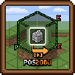

# Meshify

Export any region of a Minecraft world to OBJ and glTF, textures included.


Meshify is a client-side Fabric mod. You mark two corners in the world and it writes the blocks between them as a textured 3D model that opens in Blender or in any web glTF viewer. Nothing needs to be installed on the server, because it reads the world your client already has loaded.

Meshify is based on [pos2obj](https://www.curseforge.com/minecraft/mc-mods/pos2obj) by usagi_san, released under the MIT license. See [Credits](#credits).

## Table of contents

- [Features](#features)
- [Quick start](#quick-start)
- [Installation](#installation)
- [Usage](#usage)
- [Output](#output)
- [Development](#development)
- [Credits](#credits)
- [License](#license)

## Features

- Exports vanilla and modded blocks through their baked models, plus fluids and block entities: chests, signs and hanging signs with their text, beds, banners with their patterns, heads (player skins included), shulker boxes, decorated pots, bells and conduits. Other block entities and entities, such as item frames and the maps inside them, are captured from their own renderers.
- Writes an OBJ with its MTL and a texture atlas, plus a self-contained `.glb` for web viewers.
- Large exports don't freeze the game. The region is scanned a slice per tick, with progress and time left shown above the hotbar.
- Optional mesh reduction: merge flat surfaces into large baked quads, weld vertices, and cull hidden faces.
- Select with keys, commands or an in-game menu. The selection is kept across restarts.
- Menu and messages in English, Spanish, German, French, Brazilian Portuguese, Russian, Japanese, Korean and Simplified Chinese.

## Quick start

1. Install [Fabric Loader](https://fabricmc.net/use/) for Minecraft 1.21.11 and [Fabric API](https://modrinth.com/mod/fabric-api).
2. Build the jar (see [Development](#development)) and copy `build/libs/meshify-1.1.3.jar` into your `mods` folder.
3. In game, look at one corner of your build and press <kbd>V</kbd>. Look at the opposite corner and press <kbd>B</kbd>.
4. Run the export:

   ```
   /meshify export castle
   ```

The files land in `meshify/castle/` inside the game directory (`.minecraft` for the vanilla launcher). Click the path in chat to open the folder.

## Installation

| Requirement | Version |
| --- | --- |
| Minecraft | 1.21.11 |
| Fabric Loader | 0.17.0 or newer |
| Fabric API | any build for 1.21.11 |
| Java | 21 |

Meshify only runs on the client. There is no prebuilt release yet, so build the jar from source as described in [Development](#development) and drop it into `mods` next to Fabric API.

## Usage

### Selecting a region

| Key | Action |
| --- | --- |
| <kbd>V</kbd> | Set the start corner |
| <kbd>B</kbd> | Set the end corner |
| <kbd>N</kbd> | Open the Meshify menu |

The keys use the block under your crosshair, or the block you are standing on when you aim at nothing. You can rebind them under Controls > Key Binds > Miscellaneous.

The start corner is outlined in green, the end corner in red and the whole region in cyan. A selection belongs to one dimension: setting a corner in another dimension drops the old one, and exports refuse to run from the wrong dimension. The selection is saved to `meshify/session.properties`, so it survives a restart.

### Commands

| Command | What it does |
| --- | --- |
| `/meshify gui` | Opens the menu, same as <kbd>N</kbd>. |
| `/meshify start [x y z]` | Sets the start corner at the given coordinates, or at your feet if you leave them out. |
| `/meshify end [x y z]` | Sets the end corner the same way. |
| `/meshify here` | Selects only the block you are looking at, or the one you stand on. |
| `/meshify expand <blocks> [side]` | Grows every side of the region by `<blocks>`, or only `side`. |
| `/meshify shrink <blocks> [side]` | Shrinks every side, or only `side`. A side stops at the opposite one, so the region never turns inside out. |
| `/meshify expand vert` | Stretches the region from the bottom of the world to the build limit. |
| `/meshify trim` | Shrinks the region to the blocks inside it and drops the air around them. Every chunk in the selection has to be loaded. |
| `/meshify clear` | Clears the selection. |
| `/meshify status` | Shows both corners, the size (X×Y×Z) and the volume. |
| `/meshify export [name] [options…]` | Exports the selection. See [Exporting](#exporting). |
| `/meshify cancel` | Stops the running export and deletes what it had written so far. |
| `/meshify open` | Opens the export folder. |

`side` is one of `all`, `up`, `down`, `north`, `south`, `east`, `west` or `facing`. `facing` is the direction you are looking, up and down included.

### Exporting

```text
/meshify export [name] [options…]
```

The name becomes the folder name, so any character other than letters, digits, `_` and `-` turns into `_`. Without a name the export is called `export_<date>_<time>`. An existing export is never overwritten: a second `castle` goes to `castle_2`, then `castle_3`.

Options go after the name and can come in any order. Press <kbd>Tab</kbd> to see them. If you give no options at all, Meshify repeats the previous export's options and says so in chat. Once you give any option, the others go back to their defaults, so `/meshify export castle atlas` is a plain default export.

| Option | Default | Effect |
| --- | --- | --- |
| `atlas` | on | Packs every texture into one `atlas.png`. The `.glb` needs this. |
| `separate` | off | Writes one PNG per texture into `textures/` instead. No `.glb` is written. |
| `2`, `4`, `8`, … | `1` | Texture scale. Upscales every texture by this factor with nearest-neighbour sampling, from 1 to 16. |
| `weld` | off | Snaps vertices to a 1/1024 block grid and removes degenerate and duplicate faces. |
| `cull` | off | Also hides faces pressed against a neighbour's full opaque face. Without it, Meshify hides only the faces the game itself wouldn't draw. |
| `bake` | off | Merges flat faces that cover a whole block side into large quads and bakes their textures onto new sheets. Walls and floors end up with far fewer faces. |
| `uv<px>` | `uv16` | Bake resolution in pixels per block face, from 1 to 256. Turns `bake` on. |
| `max<px>` | `max4096` | Largest bake sheet in pixels, from 256 to 16384, rounded down to a power of two. Turns `bake` on. |

Faces on the edge of the region are always kept, so a cut through a build is never left open.

Some examples:

```text
/meshify export castle bake uv32 weld
/meshify export village separate 4
/meshify export tower cull
```

A region can hold up to 16,000,000 blocks. Above 2,000,000 Meshify warns that the export will take a while. You can keep playing while it runs. Chunks that aren't loaded export as air, so Meshify warns before it starts when part of the region is out of range. Leaving the world while the blocks are still being scanned stops the export.

### The menu

<kbd>N</kbd> or `/meshify gui` opens a menu that covers everything the commands do. You can set corners from the crosshair, expand or shrink the region by a number of blocks on one side or all of them, stretch it to full height, trim it or clear it. On the export side you pick a name and the options, start or cancel the export, and open the export folder. The menu starts with the options of your last export.

## Output

Each export gets its own folder, `meshify/<name>/`, inside the game directory:

| File | Contents |
| --- | --- |
| `<name>.obj`, `<name>.mtl` | The mesh, with one group per texture. 1 unit is 1 block, and the origin is the region's corner with the lowest X, Y and Z. |
| `atlas.png` | Every texture on one sheet (with `atlas`). |
| `textures/*.png` | One file per texture (with `separate`). With this option, light-emitting blocks get emissive materials in the MTL. |
| `<name>.glb` | A single-file glTF for web viewers. It is unlit, with Minecraft's face shading baked into the vertex colours, and uses nearest-neighbour sampling. Only written with `atlas`. |
| `export_info.txt` | The region, the options, the block, entity and face counts, skipped block types and warnings. |

Block types that nothing knows how to export are listed in chat and in `export_info.txt`.

## Development

```sh
git clone https://github.com/BakerIsCoding/Meshify.git
cd Meshify
./gradlew build
```

The mod jar is written to `build/libs/meshify-1.1.3.jar`. On Windows, use `gradlew.bat` instead of `./gradlew`.

| Task | What it does |
| --- | --- |
| `./gradlew runClient` | Starts a development client with the mod loaded. |
| `./gradlew glbCheck` | Checks the `.glb` writer output. |
| `./gradlew boxUvCheck` | Checks the cuboid texture unwrap, upright and flipped. |
| `./gradlew selectionCheck` | Checks resizing the selection and its volume. |
| `./gradlew optionsCheck` | Checks that menu choices survive the round trip through the option string. |

The checks are plain `main` methods, so the project has no test dependency. Please run them before opening a pull request.

## Credits

Meshify started as a decompile of [pos2obj](https://www.curseforge.com/minecraft/mc-mods/pos2obj) 1.1.3, the Pos2Obj Region Exporter by usagi_san, which is released under the MIT license. Meshify renames the mod and its command (`/pos` became `/meshify`), adds the menu, exports without freezing the game, and adds the resize, trim, cancel and open commands.

## License

Meshify is released under the [MIT license](./LICENSE). The license keeps usagi_san's copyright notice for the original Pos2Obj Region Exporter.
